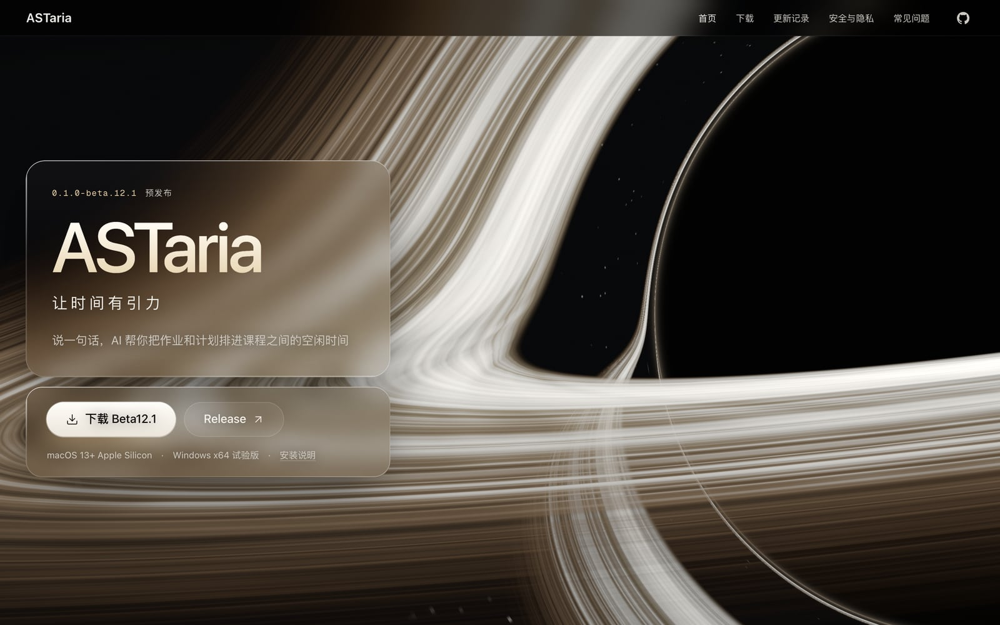
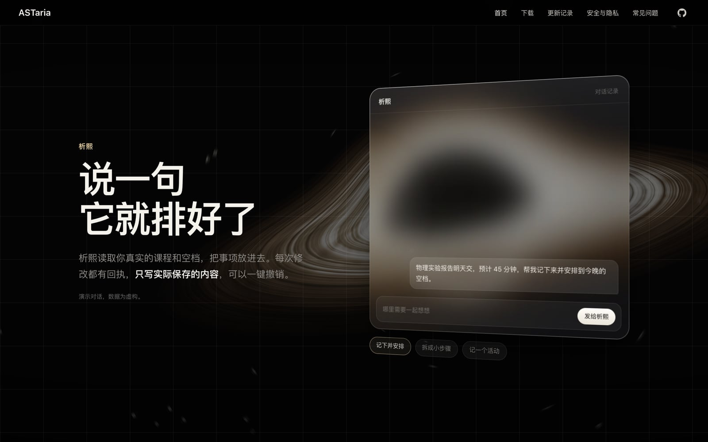
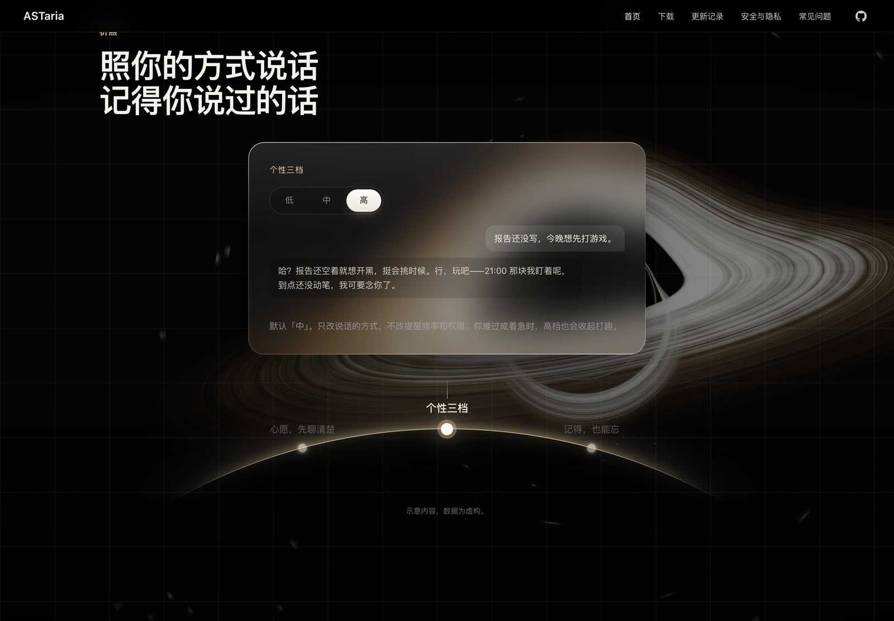
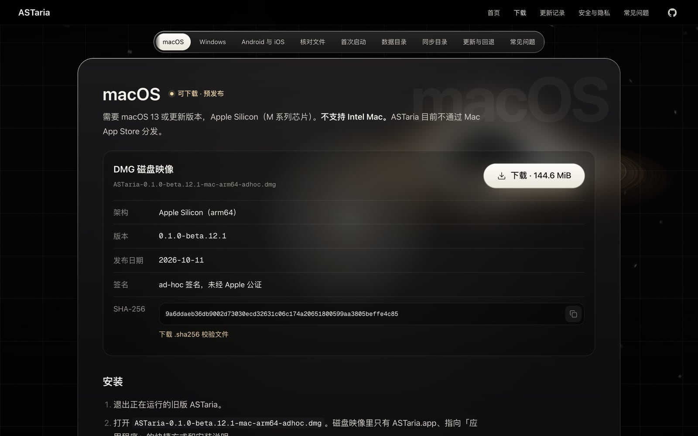
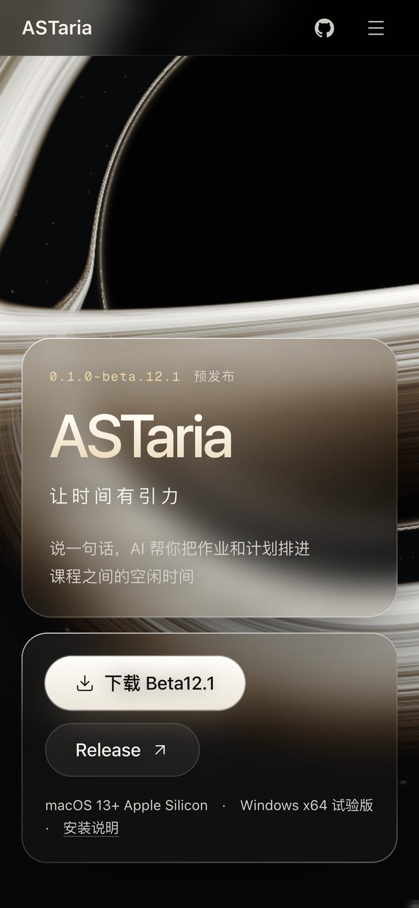
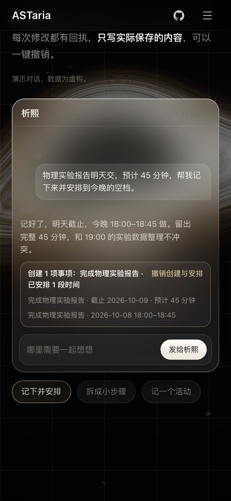
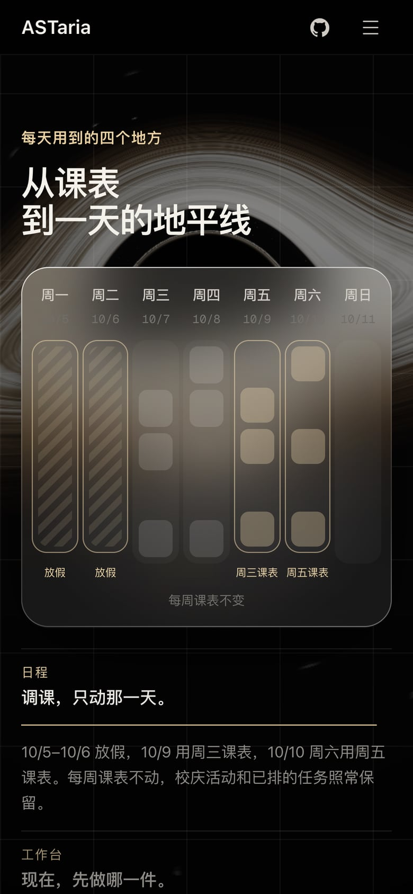
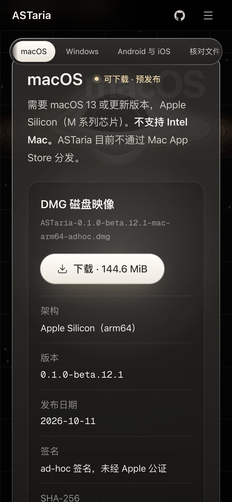

# ASTaria 官网

[ASTaria](https://github.com/Wason-dev/ASTaria) 的官方网站：<https://astaria.space>

ASTaria 是本机优先的个人时间与事项应用。和析熙聊作业、计划或心愿，把任务放进课程和日常之间的真实空档，再从工作台开始专注。



这个仓库只有网站。应用源码、安装包和发布都在 [Wason-dev/ASTaria](https://github.com/Wason-dev/ASTaria)；网站上的每个下载按钮都直接指向那里的 GitHub Release，本仓库不存放任何安装包。

## 页面

<table>
  <tr>
    <td width="50%"></td>
    <td width="50%"></td>
  </tr>
  <tr>
    <td>和析熙聊：聊天窗自动演示一段对话，回执只写实际保存的内容</td>
    <td>每天用到的四个地方：日程、工作台、余时、弦轨，各自一段画出来的示意</td>
  </tr>
  <tr>
    <td></td>
    <td></td>
  </tr>
  <tr>
    <td>析熙的四个能力排在地平线上：个性三档、记忆、模型、心愿</td>
    <td>下载与安装：文件大小、SHA-256、签名状态和安装步骤放在一起</td>
  </tr>
</table>

<table>
  <tr>
    <td width="25%"></td>
    <td width="25%"></td>
    <td width="25%"></td>
    <td width="25%"></td>
  </tr>
  <tr>
    <td>开场</td>
    <td>和析熙聊</td>
    <td>四个地方</td>
    <td>下载与安装</td>
  </tr>
</table>

截图里的应用画面与对话都是演示数据，不含任何人的课表、聊天或密钥。截图用 `node scripts/capture-readme.mjs` 重新生成（先 `npm run build`，需要本机装有 Chrome）。

## 技术

- [Astro](https://astro.build) 静态站点，构建产物是纯 HTML、CSS 和少量 JavaScript，没有服务端代码，没有统计脚本。
- 背景黑洞是一段 WebGL2 着色器：Schwarzschild 测地线查找表、吸积盘材质、光子环与选择性泛光，做法与应用一致。
- 页面上的应用画面是真实界面截图，演示数据为虚构。示意图和小交互是用 HTML 与 CSS 画的。

## 本地运行

需要 Node 22.12 或更新版本。

```bash
npm install
npm run dev
```

```bash
npm run build      # 构建到 dist/，前后各跑一遍文案检查
npm run preview    # 预览构建结果
```

## 检查

| 命令 | 作用 |
| --- | --- |
| `npm run verify:claims` | 扫描源码和构建产物，拦下不符合实际的说法（例如「已公证」「端到端加密」）和疑似密钥 |
| `npm run verify:release` | 核对 `src/data/release.ts` 与 GitHub Release 上的文件名、大小和 SHA-256 是否一致 |
| `npm run verify:links` | 检查站内链接和锚点，并请求站外链接 |

发布新版本时，只需要改 `src/data/release.ts`，再跑 `verify:release`。

## 部署

Cloudflare 直接从这个仓库构建：构建命令 `npm run build`，输出目录 `dist`。

- `public/_redirects`：旧地址 `/install/` 永久跳转到 `/download/`（Cloudflare Pages）。
- `wrangler.jsonc`：用 Cloudflare Workers 部署时的静态资源配置。
- 网站地址默认是 `https://astaria.space`，可以用环境变量 `SITE_URL` 覆盖（例如预览部署）。

## 许可证

代码采用 [Apache-2.0](LICENSE)。ASTaria 名称与标识不随许可证授予商标权，详见 [NOTICE](NOTICE)。
